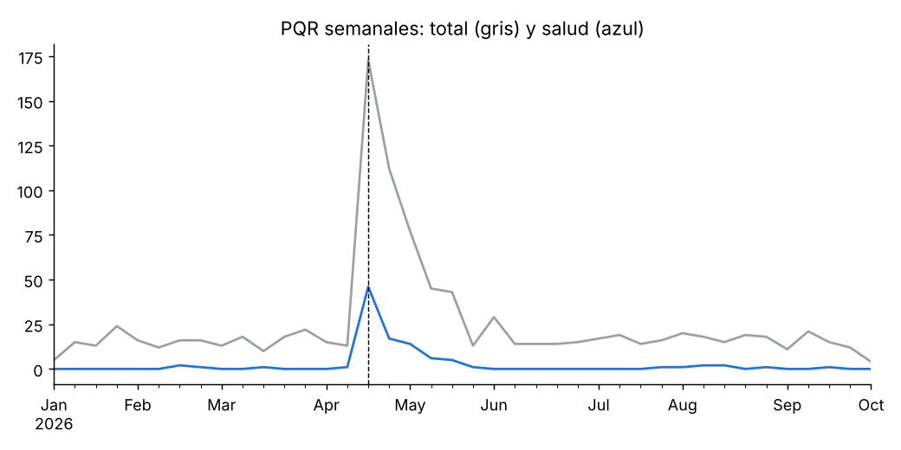
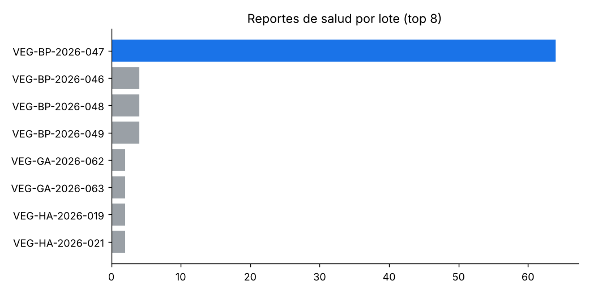
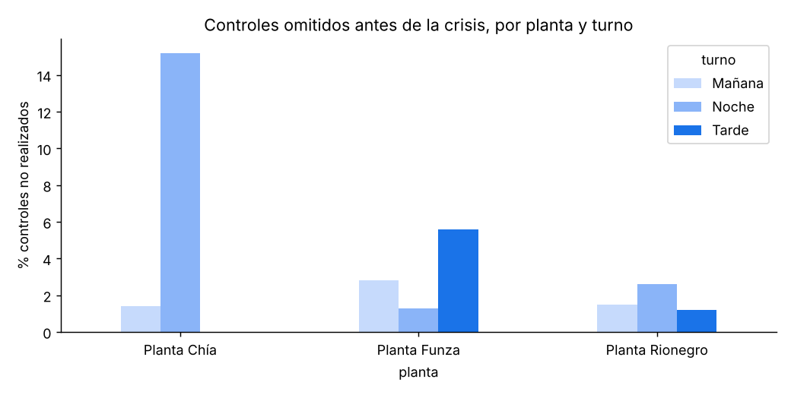
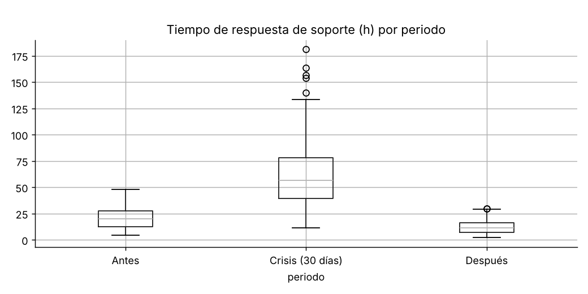
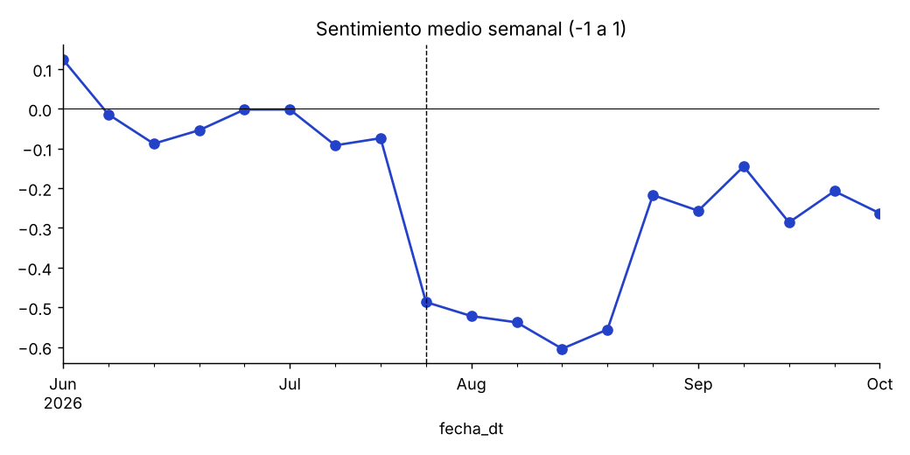
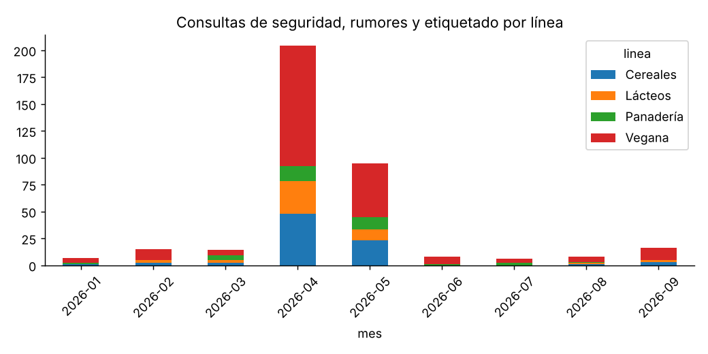
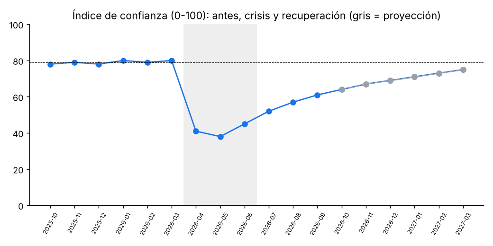

# Introducción y alcance

Alimenta Familia no enfrenta un problema de producto sino de credibilidad: un solo lote sin controles (VEG-BP-2026-047) bastó para que el público dudara de toda la organización. Este taller define la crisis, simula con IA los datos que la evidencian, los analiza, describe cómo interviene la IA en cada fase de la gestión y muestra cómo cambiaron los OKR y KPI.

**Advertencia:** todos los datos numéricos de este documento son **DATOS SIMULADOS con fines académicos**, generados con IA a partir de las cifras ancla del caso (1.025 PQR, 216 lotes, 1.307 controles, 64 reportes del lote 047). No describen un incidente real verificado. Lo que el caso no informa se marca como «No consta».

**Archivos complementarios:** carpeta `datos/` (3 libros Excel), `src/gen_datos.py`, `src/aed_alimenta_familia.py`, `resultados/figuras/` y la bitácora de uso de IA en `docs/USO_DE_IA.md`.

# 1. Definición de crisis institucional

Una **crisis institucional** es un evento inesperado que amenaza las expectativas de los grupos de interés sobre la organización, afecta seriamente su desempeño y genera consecuencias negativas que ponen en duda su legitimidad y su capacidad de cumplir lo que promete (Coombs, 2007; Coombs, 2019). No es solo un daño operativo: es una ruptura de la confianza en la institución como fuente de información y de conducta. Mitroff (2005) añade que las organizaciones que salen fortalecidas de una crisis son las que la tratan como una falla del sistema que deben corregir, no como un accidente aislado.

## Qué la diferencia de otros conceptos

| Concepto | Qué afecta | Ejemplo en el caso |
| --- | --- | --- |
| Incidente | Una operación puntual, contenible por procedimiento | El lote VEG-BP-2026-047 sale sin dos controles |
| Problema | Un proceso que falla de forma repetible | Controles omitidos en un turno de la Planta Chía |
| Crisis de comunicación | La forma de informar sobre el hecho | Una frase inventada: «el resto de productos es completamente seguro» |
| **Crisis institucional** | La credibilidad de la organización entera | «¿Podemos confiar en la información que comunica Alimenta?» |

## Aplicación al caso Alimenta Familia

- **Tipo (Teoría Situacional de Comunicación de Crisis, SCCT):** clúster *prevenible*, daño de producto por error humano u organizacional. La responsabilidad atribuida es alta porque la falla fue un control omitido, no un evento externo. La SCCT recomienda en este clúster estrategias de reconstrucción: reconocer, reparar y demostrar cambios.
- **Fase:** aguda al inicio (casos de intoxicación y discrepancias de etiquetado), crónica durante el rumor y la salida de distribuidores, y de resolución con la verificación universitaria (Fink, 1986).
- **Cuatro capas:** sanitaria (casos reportados), operativa (lote sin controles), informacional (cantidades declaradas ≠ halladas) y reputacional (duda sobre la transparencia). La salud del consumidor tiene prioridad sobre la reputación.
- **Escalamiento de la desconfianza:** Lote → Producto → Línea vegana → Marca → Organización. La paradoja: el problema técnico está localizado, la crisis no.
- **Por qué es institucional:** la propuesta de valor de Alimenta (Familia, Campo, Ciencia, Innovación) descansa en la confianza. La falla contradice la promesa, y por eso el público deja de preguntar qué pasó con el producto y empieza a preguntar si la empresa dice la verdad.

## Mapa de públicos y su necesidad principal

| Público | Necesidad principal | Responsable de la respuesta |
| --- | --- | --- |
| Consumidores afectados | Salud, atención y reparación | Atención al Consumidor |
| Consumidores de todas las líneas | Seguridad, etiquetado y confianza | Comunicación |
| Autoridades sanitarias (en Colombia, el INVIMA) | Evidencia técnica y trazabilidad | Calidad + Legal/Regulatorio |
| Distribuidores y comercios | Instrucciones de retiro y actualizaciones | Operaciones |
| Colaboradores | Protocolos y mensajes consistentes | Dirección + Comunicación |
| Productores y proveedores | Responsabilidades y continuidad | Operaciones |
| Universidades y aliados científicos | Evidencia y credibilidad | Calidad |
| Medios y comunidades digitales | Verificación, escucha y respuesta | Comunicación (vocería) |

# 2. Datos ficticios generados con IA

La IA generó tres datasets coherentes con las cifras ancla del caso. Llevan errores intencionales para que el análisis tenga algo que depurar, igual que los datos reales de una crisis. Todo está marcado como **DATO SIMULADO** y la hoja `LEEME` de cada libro documenta el prompt usado y los errores sembrados.

**Cómo intervino la IA.** A partir de un prompt estructurado con el paradigma RISE (`docs/prompt_RISE.md`), la IA escribió el código que genera los datos (`src/gen_datos.py`) respetando las cifras del caso. El equipo verificó que las cifras cuadraran con el caso y que no se violaran sus restricciones. El registro completo de qué hizo la IA y qué revisó el equipo está en `docs/USO_DE_IA.md`.

**Alcance de los datos.** Las PQR y la trazabilidad se usan para el diagnóstico (sección 3). La serie de KPI es un escenario diseñado, coherente con el caso; no se calcula a partir de las PQR, y desde octubre de 2026 es una proyección. El control de alérgenos (trazas de leche y huevo) es un control de contaminación cruzada, habitual porque la compañía también procesa lácteos. No se afirma que el producto contenga ingredientes de origen animal.

| Dataset | Registros brutos | Contenido | Errores intencionales |
| --- | --- | --- | --- |
| 01 Registro de PQR y reclamos | 1.025 PQR (ene–sep 2026) | id, fecha, canal, ciudad, producto, línea, lote, tipo, severidad 1–5, descripción, estado, tiempo de respuesta (h), sentimiento (−1 a 1) | 25 duplicados; 20 ciudades o canales vacíos; 10 lotes «N/D»; 6 fechas imposibles; 7 tiempos negativos; 5 severidades = 9 |
| 02 Trazabilidad de lotes y controles | 216 lotes y 1.307 controles | Lote, producto, fecha de producción, planta, turno, proveedor, CEDI, distribuidor; 6 controles por lote | 11 duplicados; 9 resultados vacíos; 5 fechas de control anteriores a la producción; 4 valores fuera de rango |
| 03 Serie de KPI | 18 meses (oct-2025 a mar-2027) | 11 indicadores de confianza, operación y comercial | Ninguno; oct-2026 a mar-2027 es proyección |

## Cómo los datos evidencian el problema

- El lote **VEG-BP-2026-047** (bebida proteica vegana, Planta Chía, turno noche, 2 de abril de 2026) concentra **64 reportes únicos de salud**.
- En ese lote, los controles de *Bacillus cereus* y alérgenos figuran como «No realizado», y la proteína medida (14,2 g/100 g) no coincide con la declarada (20 g/100 g): ahí están las capas sanitaria, operativa e informacional.
- **23 reportes de salud** mencionan otros lotes sin respaldo de laboratorio. Los lotes 046 y 048 tienen sus 6 controles conformes.
- Las consultas de seguridad, el etiquetado y el rumor del documento falso suben después del 14 de abril también en lácteos, panadería y cereales: es la capa reputacional.

## Prompts usados para generar los datos

> **PQR:** «Genera un dataset simulado de 1.025 PQR de Alimenta Familia (ene–sep 2026) con las columnas indicadas; incluye 64 reportes únicos de salud del lote VEG-BP-2026-047 concentrados tras el 14-abr-2026, 23 reportes de salud que mencionan otros lotes sin respaldo de laboratorio y errores intencionales documentados.»

> **Trazabilidad:** «Genera la trazabilidad simulada de 216 lotes y 1.307 registros de control (6 por lote + 11 duplicados). El lote VEG-BP-2026-047 (Planta Chía, turno noche) tiene *Bacillus cereus* y alérgenos 'No realizado' y proteína declarada de 20 g frente a 14,2 g medidos. Los lotes 046 y 048 son conformes.»

> **KPI:** «Genera una serie mensual simulada de 18 meses con los KPI de confianza, operación y comercial, marcando las fases Antes, Crisis (abr–jun 2026) y Recuperación.»

El código que los reproduce (`src/gen_datos.py`, semilla 2026) permite regenerar exactamente los mismos datos.

# 3. Análisis exploratorio de datos

El AED confirma que el problema técnico está en un solo lote y la desconfianza en todo el portafolio. El lote VEG-BP-2026-047 concentra 64 de los 102 reportes de salud (63 %), sus dos controles críticos no se hicieron, y aun así las consultas de seguridad llegaron desde las cuatro líneas de producto.

## 3.1 Preguntas correctas

Siguiendo a Tukey (1977), el análisis parte de preguntas y deja que los datos sugieran patrones antes de confirmar cualquier hipótesis.

1. **P1.** ¿Los reportes de salud se concentran en un lote o se distribuyen en el portafolio?
2. **P2.** ¿Qué controles se omitieron y en qué planta y turno ocurre con más frecuencia?
3. **P3.** ¿Hay evidencia de laboratorio para los reportes que mencionan otros lotes?
4. **P4.** ¿Cómo cambiaron el volumen, el tiempo de respuesta y el sentimiento de las PQR tras la crisis?
5. **P5.** ¿La desconfianza se extendió a productos y líneas no afectados técnicamente?

## 3.2 Caracterización de los datos

| Fuente | Origen y responsable | Periodo | Unidad de análisis | Variables clave |
| --- | --- | --- | --- | --- |
| Registro de PQR | Atención al Consumidor | 2-ene a 30-sep-2026 | Una PQR | fecha, canal, lote, tipo, severidad, tiempo de respuesta, sentimiento |
| Trazabilidad: Lotes | Operaciones | Producción ene–jun 2026 | Un lote | planta, turno, proveedor, CEDI, distribuidor, fechas |
| Trazabilidad: Controles | Calidad | Ene–jun 2026 | Un control por lote | tipo de control, valor medido, resultado |
| Serie de KPI | Dirección y Comunicación | Oct-2025 a mar-2027 | Un mes | 11 indicadores |

La llave común entre PQR y trazabilidad es el **lote**. El 42 % de las PQR no trae lote (sobre todo consultas y felicitaciones), así que el cruce por lote solo cubre las PQR que lo informan.

## 3.3 Detección de datos atípicos

- **Errores de validez (reglas de negocio):** 6 fechas imposibles (por ejemplo 2062-04-15 o el mes 13), 7 tiempos de respuesta negativos, 5 severidades fuera de la escala 1–5, 5 controles fechados antes de producir el lote y 4 valores medidos imposibles (−3,5 o 999).
- **Atípicos estadísticos (método IQR):** en el tiempo de respuesta, Q1 = 18,6 h, Q3 = 65,7 h y límite superior = Q3 + 1,5 × IQR = 136,4 h. 20 PQR lo superan; todas caen en la ventana de crisis. **No se eliminan**: son la señal del colapso del canal de atención, no ruido. Se usa IQR y no z-score porque la distribución es asimétrica (gamma).

## 3.4 Limpieza de los datos

| Base | Hallazgo | Registros | Tratamiento |
| --- | --- | --- | --- |
| PQR | Duplicados exactos | 25 | Se eliminan |
| PQR | Fechas imposibles | 6 | Se excluyen del análisis temporal |
| PQR | Tiempo de respuesta negativo | 7 | Valor absoluto (error de signo) |
| PQR | Severidad = 9 | 5 | Se anula |
| PQR | Lote «N/D» | 10 | Se convierte a nulo |
| PQR | Ciudad o canal vacíos | 20 | Se conservan como «Sin dato» |
| Controles | Duplicados exactos | 11 | Se eliminan |
| Controles | Resultado vacío | 9 | «Sin registro»; nunca se asume conforme |
| Controles | Fecha de control previa a la producción | 5 | Se marca para verificar con Calidad |
| Controles | Valor fuera de rango | 4 | Se anula el valor |

Resultado: 1.025 → **994 PQR válidas** y 1.307 → **1.296 controles** (216 lotes × 6). La IA reporta cada corrección en vez de ocultarla, que es lo que exige la fase Escuchar.

## 3.5 Patrones

- **P1. Concentración:** de 102 reportes de salud, 64 corresponden al lote 047, 23 mencionan otros 11 lotes (ninguno con más de 4 reportes), 1 es la consulta de agosto sobre el lote VEG-GA-2026-063 y 14 no informan lote.
- **P2. Omisiones:** antes de la crisis, la Planta Chía en turno noche omitió el **15,2 %** de sus controles, frente a un rango de 0 % a 5,6 % en las otras ocho combinaciones de planta y turno. Después del 14 de abril, las omisiones bajan a **0 %**. El problema es de proceso en un turno, no de toda la planta.
- **P3. Evidencia:** los 11 lotes mencionados en los 23 reportes tienen todos sus controles conformes, incluidos el 046 y el 048 (6 de 6). Esos reportes quedan como «Por confirmar», no como confirmados.
- **P4. Atención:** las PQR pasan de 2,2 por día antes de la crisis a 8,5 por día en los 60 días siguientes. La mediana de respuesta sube de 25 h a 64 h y el sentimiento medio cae de −0,10 a −0,69. Después se recupera: 14,9 h de mediana y sentimiento de −0,28.
- **P5. Contagio:** de 373 consultas de seguridad, reclamos de etiquetado y rumores, 164 (44 %) son de líneas sin ningún problema técnico: cereales (80), lácteos (49) y panadería (35).

## 3.6 Ficha única de hechos (resultado del AED)

| Dato | Estado | Fuente |
| --- | --- | --- |
| El lote VEG-BP-2026-047 se produjo el 2-abr-2026 en la Planta Chía, turno noche | Confirmado | Trazabilidad: Lotes |
| Sus controles de *Bacillus cereus* y alérgenos no se realizaron | Confirmado | Trazabilidad: Controles |
| Proteína medida 14,2 g/100 g frente a 20 g declarados | Confirmado | Trazabilidad: Controles |
| 64 reportes únicos de salud asociados a ese lote | Confirmado (como reportes, no como diagnóstico) | Registro de PQR |
| Los lotes 046 y 048 tienen análisis conformes (6 de 6) | Confirmado | Trazabilidad: Controles |
| 23 reportes de salud asociados a otros lotes | Por confirmar | PQR sin respaldo de laboratorio |
| Agente causal de la intoxicación | No consta | Sin análisis del agente |
| Responsabilidad del proveedor | No consta | Investigación abierta |
| Seguridad del resto del portafolio | No consta | Solo hay análisis de los lotes 046 y 048 |

Calidad y Jurídica firman esta ficha. Nada se publica si no está en ella.

# 4. Proceso paso a paso y cómo interactúa la IA

En cada fase la IA ordena, verifica y ensaya, y una persona decide qué se dice y quién lo dice. El ciclo sigue la lógica del caso: Escuchar → Diagnosticar → Informar/Comunicar → Dialogar → Actuar → Recuperar confianza.

## 4.1 Detalle por fase

Las fases 2 a 4 aplican las estrategias de reparación de imagen de Benoit (1997): reconocer, corregir y mostrar la acción correctiva, siempre con hechos verificados.

| Fase | Situación | Objetivo | Los 5 pasos de la IA | Herramienta sugerida | Decisión humana | Riesgo que se evita |
| --- | --- | --- | --- | --- | --- | --- |
| 1. Escuchar | El gerente quiere que una IA responda todo en redes ya | Fijar los hechos antes de hablar | Ingerir las 2 bases → depurar y reportar errores → cruzar PQR y controles por lote → clasificar (Confirmado / Por confirmar / No consta) → entregar la ficha y detenerse | ChatGPT (sintetizar), Grok (escuchar redes) | Calidad y Jurídica firman la ficha | Responder con datos sucios o inventados |
| 2. Diagnosticar | Aparece una frase inventada: «el resto de nuestros productos es completamente seguro» | Que ningún mensaje salga sin respaldo | Recibir ficha y borrador → dividir en afirmaciones → contrastar (respaldada / sin respaldo / contradicha) → marcar y explicar → reescribir solo con la ficha | Claude (revisar documentos) | Jurídica aprueba cada mensaje; personas atienden a los afectados | Afirmaciones tranquilizadoras falsas |
| 3. Informar y comunicar | Circula un documento falso; los distribuidores retiran la línea; el gerente propone cuentas falsas | Responder al rumor con verdad y una sola voz | Recibir mensajes aprobados y frases prohibidas → hacer de periodista hostil → (la vocera responde) → calificar de 1 a 5 citando la frase → proponer una versión mejor | Perplexity (contrastar), Grok (rastrear rumor), ElevenLabs (voz de catálogo) | La junta rechaza las cuentas falsas; la directora de Calidad da la cara | Desinformación propia, culpar sin pruebas |
| 4. Dialogar | La planta se abre y una universidad verifica los controles | Mostrar en vez de prometer | Recibir informe y anexo de evidencias → dividir en frases → buscar evidencia por frase → clasificar hecho / promesa / sin evidencia → entregar lo anunciable hoy | Claude (revisar), Gemini (organizar) | Calidad revisa cada alerta; solo se anuncia lo hecho | Vender promesas como logros |
| 5. Actuar | Nuevo reporte sobre el lote VEG-GA-2026-063 | Rastrear en horas, no en días | Recibir el reporte → ubicar el lote (Planta Chía, 16-may, turno noche) → revisar sus 6 controles (conformes) → seguir la ruta (CEDI Bucaramanga → tienda, recibido el 27-may; compra el 15-ago) → concluir con lo que no sabe | ChatGPT con análisis de datos | La empresa comunica aunque no esté obligada | Silencio u ocultamiento cuando el resultado favorece |
| 6. Recuperar confianza | La junta invita a todos los públicos | Que cada público vea su evidencia | Agrupar la evidencia por público → armar una carpeta por público → actualizar el tablero de KPI → señalar vacíos → preparar el resumen | Gemini (organizar), Artlist (pieza audiovisual) | Cada público decide si vuelve a creer | Declarar la confianza recuperada sin medirla |

## 4.2 Prompts de ejemplo por fase

1. **Escuchar:** «Actúa como analista de calidad. Con estos dos archivos, reporta duplicados, vacíos y valores imposibles sin corregirlos en silencio. Cruza reclamos y controles por lote y clasifica cada dato como Confirmado, Por confirmar o No consta, citando el archivo y la fila. No redactes mensajes públicos.»
2. **Diagnosticar:** «Divide este comunicado en afirmaciones numeradas. Compara cada una con la ficha de hechos adjunta y marca si está respaldada, sin respaldo o contradicha, con el motivo en una línea. Luego reescríbelo usando solo lo que consta; si falta un dato, escribe 'no consta'.»
3. **Informar:** «Haz de periodista hostil de un medio nacional. Hazme 10 preguntas incómodas sobre el lote 047. Evalúa cada respuesta mía de 1 a 5 en exactitud, honestidad sobre lo que no sabemos y uso de frases prohibidas, y cita mi frase exacta.»
4. **Dialogar:** «Clasifica cada frase de este informe como hecho con evidencia (cita el código del anexo), promesa o sin evidencia. Si una frase mezcla hecho y promesa, divídela. Entrega solo la lista de lo que se puede anunciar hoy.»
5. **Actuar:** «Con la trazabilidad adjunta, rastrea el lote VEG-GA-2026-063: producción, controles y ruta hasta la tienda. Indica si la compra fue posterior a la recepción, las filas de origen de cada dato y lo que no se puede concluir.»
6. **Recuperar:** «Organiza estas evidencias en una carpeta por público (consumidores, INVIMA, distribuidores, colaboradores) y señala qué público aún no tiene evidencia suficiente.»

## 4.3 Los 8 pasos de comunicación de crisis con IA

| Paso | Qué hace Comunicación | Resultado | La IA podría |
| --- | --- | --- | --- |
| 1. Activar canales institucionales | Definir fuentes oficiales: web, redes, línea de atención, correo | Una sola versión oficial | Redactar un comunicado único y avisar si dos mensajes se contradicen |
| 2. Identificar personas clave | Mapa de periodistas, líderes de opinión, distribuidores y aliados | Saber con quién hablar, para qué y cuándo | Ordenar los actores por influencia |
| 3. Informar a los colaboradores | Contar qué pasó, qué lote, qué se hace y qué responder | Menos rumores internos | Redactar preguntas frecuentes desde la ficha |
| 4. Preparar la vocería | Designar voceros; mensajes clave y preguntas difíciles | Mensaje coherente y respaldado | Simular un periodista y calificar respuestas |
| 5. Comunicar el retiro del lote | Cómo identificar el lote, dónde devolverlo, qué hacer si se consumió | Proteger al consumidor | Adaptar el aviso a cada canal y revisar que se entienda |
| 6. Gestionar la institucionalidad | Contacto documentado con autoridades | Cooperación y menos vacíos | Resumir avances solo con evidencias |
| 7. Mapear la esfera pública | Actores, narrativas, críticas y desinformación | Entender la crisis fuera de los canales propios | Clasificar menciones y marcar rumores para revisión humana |
| 8. Relacionarse con los afectados | Escucha, orientación y solución antes que defensa | Atender el daño | Ordenar casos y sugerir borradores; la llamada la hace una persona |

## 4.4 Límites de la IA en este proceso

- No publica ni responde en redes por sí misma.
- No atiende a los afectados; ordena casos para que los atienda una persona.
- No determina causas clínicas ni sustituye las decisiones sanitarias de INVIMA ni de Calidad.
- No crea cuentas, voces ni testimonios falsos. Si se usa voz sintética para ensayar, es una voz de catálogo y nunca la de una persona real.
- Todo lo que produce es un borrador hasta que lo firma el responsable.

# 5. OKR y KPI: antes, durante y después de la crisis

Antes de la crisis los OKR medían crecimiento; después miden confianza verificable. La crisis no solo hundió los indicadores comerciales: mostró que la empresa no medía lo que sostenía su propuesta de valor (controles realizados, trazabilidad y veracidad de lo que comunica).

## 5.1 OKR antes de la crisis y cómo se afectaron

| OKR previo (2026) | Resultado clave | Valor antes | Valor en crisis | Efecto |
| --- | --- | --- | --- | --- |
| O1. Liderar la categoría vegana en Colombia | Ventas de la línea vegana ≥ 400 MM COP/mes | 410 (mar-26) | 60 (may-26) | Caída de 85 %; los distribuidores retiran la línea |
| O2. Ser la marca familiar más recomendada | NPS ≥ 45 | 47 | −18 | Pasa a terreno negativo |
| O3. Excelencia operativa | Controles de calidad realizados ≥ 95 % | 96,8 % | 99,1 % → 100 % | La meta se cumplía en promedio y escondía un turno con 15,2 % de omisión |
| O4. Fidelizar al consumidor | Recompra ≥ 40 % | 42 % | 19 % | Se pierde más de la mitad de la recompra |

La lección de O3 es central: un promedio de 96,8 % parecía sano, pero no exigía el 100 % por lote ni desagregaba por planta y turno.

## 5.2 OKR reformulados después de la crisis

Siguiendo a Doerr (2018), cada objetivo es cualitativo y cada resultado clave es medible y verificable.

- **O1. Que cada público pueda comprobar que la información de Alimenta es veraz.**
    - KR1. 100 % de los mensajes públicos auditados contra la ficha de hechos antes de publicarse.
    - KR2. Relación hechos con evidencia / promesas ≥ 3 en los informes públicos.
    - KR3. Índice de confianza ≥ 75 a marzo de 2027.
- **O2. Que ningún lote salga sin sus controles completos.**
    - KR1. 100 % de los controles realizados por lote, medido por lote y no en promedio.
    - KR2. Tiempo de rastreo de un lote ≤ 4 horas.
    - KR3. Verificación externa semestral de una universidad aliada.
- **O3. Atender primero a las personas.**
    - KR1. Tiempo medio de respuesta a PQR ≤ 12 horas.
    - KR2. 100 % de los afectados con seguimiento de una persona.
- **O4. Recuperar la línea vegana con evidencia, no con publicidad.**
    - KR1. ≥ 95 % de distribuidores con la línea activa.
    - KR2. Ventas ≥ 410 MM COP/mes y recompra ≥ 42 %.

## 5.3 Tablero de KPI

| KPI | Fórmula | Fuente | Frecuencia | Responsable | Antes | May-2026 (pico de crisis) | Sep-2026 | Mar-2027 (proy.) | Meta |
| --- | --- | --- | --- | --- | --- | --- | --- | --- | --- |
| Índice de confianza (0–100) | Promedio de la escala de confianza de la encuesta | Encuesta a consumidores | Mensual | Comunicación | 79 | 38 | 61 | 75 | ≥ 75 |
| Sentimiento neto (%) | (menciones positivas − negativas) / total | Escucha social | Semanal | Comunicación | 35 | −55 | 3 | 27 | ≥ 25 |
| NPS | % promotores − % detractores | Encuesta | Mensual | Mercadeo | 47 | −18 | 21 | 40 | ≥ 40 |
| Controles realizados (%) | controles realizados / exigidos, por lote | Trazabilidad | Por lote | Calidad | 96,8 | 100 | 100 | 100 | 100 |
| Tiempo de rastreo de un lote (h) | horas entre el reporte y la ruta completa | Trazabilidad + PQR | Por evento | Operaciones | 72 | 36 | 6 | 4 | ≤ 4 |
| Tiempo de respuesta a PQR (h) | promedio de horas a primera respuesta | Registro de PQR | Semanal | Atención al Consumidor | 28,5 | 74 | 17 | 12 | ≤ 12 |
| Distribuidores activos (%) | distribuidores con la línea vegana / total | Comercial | Mensual | Comercial | 100 | 58 | 85 | 96 | ≥ 95 |
| Mensajes auditados (%) | mensajes revisados contra la ficha / publicados | Registro de comunicaciones | Por mensaje | Jurídica | No se medía | 95 | 100 | 100 | 100 |
| Hechos / promesas | frases con evidencia / frases promesa | Informes públicos | Por informe | Calidad | No se medía | 0,9 | 2,6 | 3,4 | ≥ 3 |
| Ventas línea vegana (MM COP/mes) | ventas netas mensuales | ERP | Mensual | Comercial | 410 | 60 | 265 | 430 | ≥ 410 |
| Recompra (%) | clientes que repiten en 60 días / compradores | Panel de hogares | Mensual | Mercadeo | 42 | 19 | 34 | 41 | ≥ 42 |

«Antes» es el promedio de oct-2025 a mar-2026 (en ventas, mar-2026, porque la línea se lanzó en febrero). Los tiempos de respuesta de esta serie son promedios mensuales; el AED reporta medianas, por eso difieren. Dos KPI nuevos, mensajes auditados y hechos/promesas, no existían antes: la crisis los creó.

# 6. Plan de acción recomendado (90 días)

Proponemos ocho acciones críticas: cinco victorias rápidas en los primeros 45 días y tres proyectos estratégicos al día 90. La primera ataca directamente la causa raíz encontrada en el análisis: ningún lote sale de planta sin sus seis controles.

**Costo de no actuar.** Entre abril y septiembre de 2026, la línea vegana dejó de vender **1.560 MM COP** frente a su nivel de marzo (410 MM COP al mes). Marzo es el único mes completo antes de la crisis, porque la línea se lanzó en febrero; la cifra es un orden de magnitud sobre datos simulados.

## 6.1 Ocho acciones críticas

Los puntajes de impacto y esfuerzo (de 1 a 10) son criterio del equipo, no datos del caso.

| # | Acción | Responsable | Indicador que mueve | Impacto | Esfuerzo | Tipo | Días |
| --- | --- | --- | --- | --- | --- | --- | --- |
| 1 | Bloqueo de liberación: ningún lote sale sin 6/6 controles | Calidad | Controles por lote: 100 % | 9,6 | 1,8 | Victoria rápida | 0–10 |
| 2 | Ficha única de hechos + auditoría con IA de cada mensaje | Comunicación y Jurídica | Mensajes auditados: 100 % | 9,0 | 2,6 | Victoria rápida | 0–14 |
| 3 | Atención humana a afectados, priorizada con IA | Atención al Consumidor | Respuesta ≤ 12 h | 8,2 | 4,2 | Victoria rápida | 0–30 |
| 4 | Auditoría y capacitación del turno noche, Planta Chía | Operaciones | Omisión por turno: 0 % | 8,0 | 3,4 | Victoria rápida | 7–45 |
| 5 | Escucha social y protocolo contra rumores | Comunicación | Sentimiento neto > 0 | 6,2 | 3,0 | Victoria rápida | 14–40 |
| 6 | Kit de evidencia por lote para distribuidores | Comercial | Distribuidores ≥ 95 % | 7,4 | 5,6 | Estratégico | 30–60 |
| 7 | Trazabilidad lote → tienda | Operaciones y TI | Rastreo ≤ 4 h | 8,8 | 7,6 | Estratégico | 20–80 |
| 8 | Verificación universitaria + informe de hechos | Dirección | Hechos/promesas ≥ 3 | 7,8 | 6,6 | Estratégico | 45–90 |

## 6.2 Hoja de ruta

- **Día 30:** ningún lote sale incompleto, la ficha de hechos opera y los afectados reciben respuesta en menos de 12 horas.
- **Día 60:** el turno noche está auditado y capacitado, y los distribuidores tienen evidencia por lote para volver a vender.
- **Día 90:** cualquier lote se rastrea en 4 horas y se publica el primer informe de hechos verificado por una universidad.

## 6.3 Retorno esperado (proyección simulada)

| Indicador | Sep-2026 | Mar-2027 (proyección) | Cambio |
| --- | --- | --- | --- |
| Ventas de la línea vegana (MM COP/mes) | 265 | 430 | +165 |
| Distribuidores activos (%) | 85 | 96 | +11 p. p. |
| Índice de confianza (0–100) | 61 | 75 | +14 |
| Recompra (%) | 34 | 41 | +7 p. p. |

Además, el plan reduce el riesgo legal de comunicar afirmaciones sin respaldo y permite retirar un lote en lugar de una línea completa.

## 6.4 Decisiones que se le piden a la Junta

1. Aprobar esta semana el bloqueo de liberación (acción 1).
2. Nombrar un dueño de la ficha única de hechos, con firma de Calidad y Jurídica (acción 2).
3. Financiar la trazabilidad lote → tienda para rastrear cualquier lote en 4 horas (acción 7).

# Conclusiones y lecciones aprendidas

1. **La crisis fue de credibilidad, no de producto.** Un lote concentró 64 reportes de salud, pero el 44 % de las consultas de seguridad, etiquetado y rumores llegó de líneas sin ningún problema técnico.
2. **Un promedio sano puede esconder la falla.** Controles realizados al 96,8 % cumplían la meta mientras la Planta Chía, en turno noche, omitía el 15,2 %. Los KPI críticos se miden por lote, planta y turno.
3. **Primero los hechos, después las palabras.** La ficha única de hechos, con estados Confirmado / Por confirmar / No consta, es el insumo de toda la comunicación posterior.
4. **La misma IA que inventa una frase puede cazarla.** Su valor no está en hablar más rápido sino en depurar, cruzar, verificar y ensayar; la decisión y el contacto con los afectados son humanos.
5. **Confianza = mensaje + evidencia + consistencia + acción.** Por eso los OKR reformulados miden mensajes auditados, hechos frente a promesas y tiempo de rastreo, no solo ventas y NPS.
6. **La transparencia se prueba cuando no conviene y cuando sí.** Comunicar el resultado favorable del lote VEG-GA-2026-063 fue tan importante como reconocer el 047.

# Referencias

- Benoit, W. L. (1997). Image repair discourse and crisis communication. *Public Relations Review, 23*(2), 177–186.
- Coombs, W. T. (2007). Protecting organization reputations during a crisis: The development and application of situational crisis communication theory. *Corporate Reputation Review, 10*(3), 163–176.
- Coombs, W. T. (2019). *Ongoing crisis communication: Planning, managing, and responding* (5.ª ed.). SAGE.
- Doerr, J. (2018). *Measure what matters: How Google, Bono, and the Gates Foundation rock the world with OKRs*. Portfolio/Penguin.
- Fink, S. (1986). *Crisis management: Planning for the inevitable*. AMACOM.
- Mitroff, I. I. (2005). *Why some companies emerge stronger and better from a crisis*. AMACOM.
- Tukey, J. W. (1977). *Exploratory data analysis*. Addison-Wesley.
- Universidad de La Sabana. (2026). *Alimenta Familia: cuando un fallo de calidad se convierte en una crisis de confianza* [Presentación del caso de estudio]. Material de clase.
