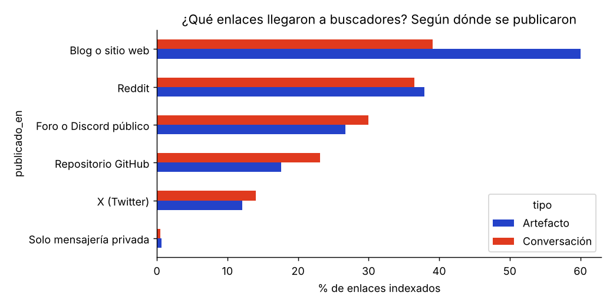
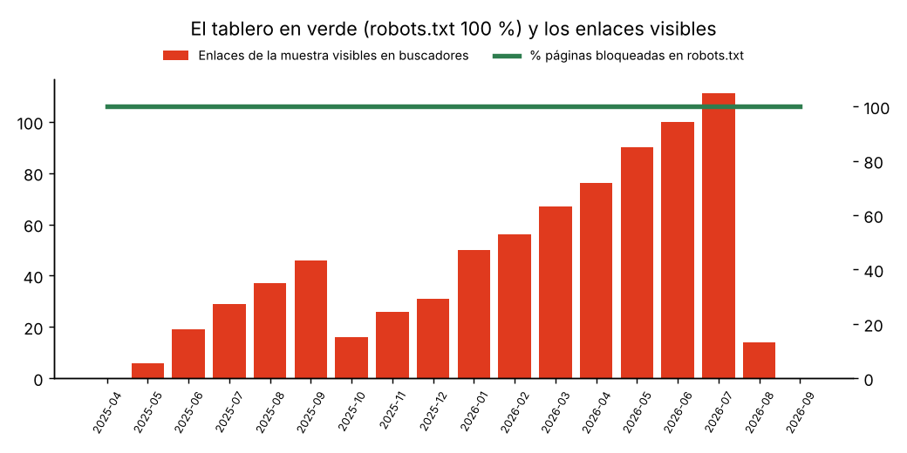
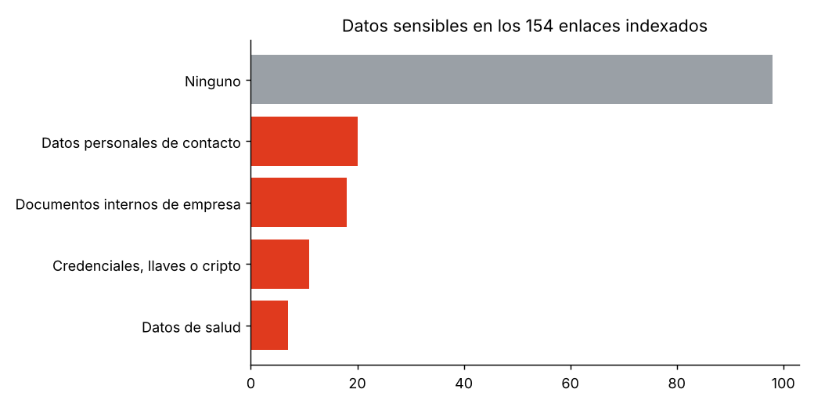
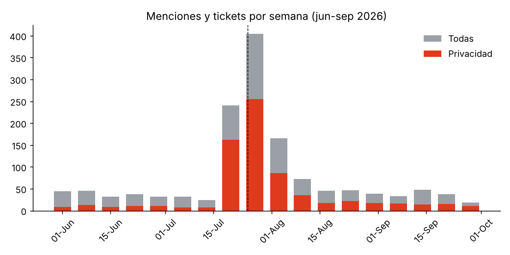
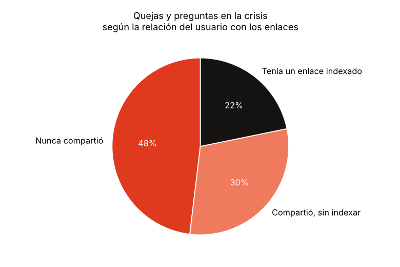
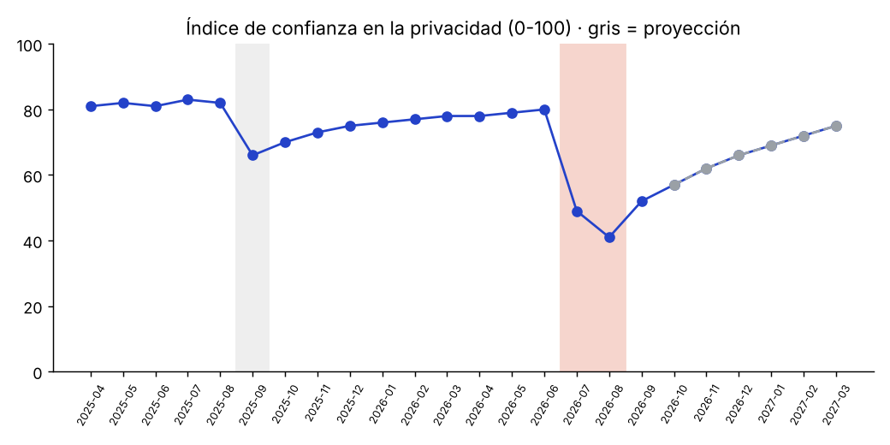

# Introducción y alcance

En julio de 2026, conversaciones y artefactos de Claude que sus usuarios habían compartido mediante enlaces públicos aparecieron en los resultados de Google y Bing. Algunos contenían llaves de billeteras de criptomonedas, hojas de vida, documentos internos de empresas y datos personales. No era la primera vez: en septiembre de 2025 Google ya había indexado cerca de 600 conversaciones de Claude. Este taller define la crisis institucional que eso provoca, simula con IA los datos que la evidencian, los analiza, describe cómo interviene la IA en cada fase de su gestión y muestra cómo se afectan y se reforman los OKR y KPI.

**Hechos y datos.** Los **hechos** del caso (fechas, comunicados y mecanismo técnico) son públicos y están citados. Las **cifras** de las tablas, figuras y KPI son **DATOS SIMULADOS con fines académicos**, generados con IA de forma coherente con esos hechos. No son métricas reales de Anthropic y no deben citarse como tales. Lo que no consta en fuentes públicas se marca como «No consta». Este trabajo es un ejercicio académico y no está afiliado a Anthropic ni avalado por ella.

**Archivos complementarios:** carpeta `datos/` (3 libros Excel), `src/gen_datos.py`, `src/aed_claude_enlaces.py`, `resultados/figuras/` y la bitácora de uso de IA en `docs/USO_DE_IA.md`.

## Qué pasó (hechos públicos)

| Fecha | Hecho | Fuente |
| --- | --- | --- |
| Jun-2024 | Anthropic lanza los artefactos (*Artifacts*), contenidos interactivos que también se pueden compartir con un enlace. | VentureBeat (2026) |
| 8–9 sep-2025 | Google estima que tenía indexadas poco menos de 600 conversaciones compartidas de Claude y las retira. Anthropic afirma que no comparte directorios ni sitemaps con los buscadores y que bloquea su rastreo. | Forbes Australia (2025) |
| 25 jul-2026 | Un usuario de r/ClaudeAI muestra que la búsqueda `site:claude.ai/share` devuelve conversaciones compartidas. | VentureBeat (2026) |
| 26 jul-2026 | Se reportan también artefactos públicos en los resultados; muchos resultados empiezan a desaparecer ese mismo día. | VentureBeat (2026) |
| 26–28 jul-2026 | La prensa reporta llaves de billeteras cripto, nombres, direcciones, hojas de vida y documentos internos en algunos chats. Anthropic reitera que los enlaces no se pueden adivinar ni descubrir si las personas no los comparten, y que lo compartido es público y puede ser archivado por terceros. | Nolan (2026); Kan (2026); BeInCrypto (2026) |
| 27 jul-2026 | Se documenta el mecanismo: robots.txt bloquea `/share/`, de modo que el buscador no puede leer la directiva *noindex* de la página, pero sí puede indexar la URL si otros sitios la enlazan. | Search Engine Journal (2026); Google (s. f.) |
| 28 jul-2026 | La búsqueda `site:claude.ai/share` ya no devuelve resultados, aunque los enlaces siguen abiertos para quien los tenga hasta que su dueño los desactive. | Kan (2026) |

# 1. Definición de crisis institucional

Una **crisis institucional** es un evento inesperado que amenaza las expectativas de los grupos de interés sobre la organización, afecta seriamente su desempeño y pone en duda su legitimidad y su capacidad de cumplir lo que promete (Coombs, 2007; Coombs, 2019). No es solo un daño operativo: es una ruptura de la confianza en la institución. Mitroff (2005) añade que las organizaciones que salen fortalecidas de una crisis son las que la tratan como una falla del sistema que deben corregir, no como un accidente aislado.

## Qué la diferencia de otros conceptos

| Concepto | Qué afecta | Ejemplo en el caso |
| --- | --- | --- |
| Incidente | Una operación puntual, contenible por procedimiento | Un enlace compartido aparece en Google |
| Problema | Un proceso que falla de forma repetible | Las páginas compartidas se bloquean en robots.txt en lugar de marcarse con un *noindex* legible |
| Crisis de comunicación | La forma de informar sobre el hecho | Responder que el problema existe solo porque los usuarios publicaron sus enlaces |
| **Crisis institucional** | La credibilidad de la organización entera | «¿Puedo confiarle mis datos a una empresa que se presenta como de seguridad de IA?» |

## Aplicación al caso Claude

- **Tipo (Teoría Situacional de Comunicación de Crisis, SCCT):** por sí solo, el hecho encaja en el clúster *accidental* (falla técnica sin intención). Pero la SCCT indica que el **historial de crisis** eleva la responsabilidad atribuida (Coombs, 2007): como ya había pasado en septiembre de 2025, el público lo juzga como **prevenible**. En ese caso la SCCT recomienda estrategias de reconstrucción: reconocer, reparar y demostrar cambios.
- **Brecha de legitimidad:** Anthropic se presenta como una empresa de investigación y seguridad de IA. La crisis golpea justo esa promesa, por eso no se queda en lo técnico.
- **Fase:** aguda entre el 25 y el 28 de julio (descubrimiento, cobertura y retiro de resultados), crónica mientras los enlaces siguen vivos y circulan copias, y de resolución cuando la corrección se puede verificar (Fink, 1986).
- **Cuatro capas:** de privacidad (datos sensibles expuestos), técnica (bloquear el rastreo no impide indexar), informacional (los usuarios entendían «cualquiera con el enlace» como «privado», no como «buscable») y reputacional (la duda llega a quien nunca compartió nada).
- **Escalamiento de la desconfianza:** Enlace → Conversación → Función Compartir → Claude → Anthropic. La paradoja: el problema técnico está localizado; la crisis, no.

## Mapa de públicos y su necesidad principal

| Público | Pregunta que se hace | Lo que necesita recibir |
| --- | --- | --- |
| Usuarios con enlaces expuestos | ¿Qué de lo mío quedó público y cómo lo apago? | Aviso individual, lista de sus enlaces y cómo desactivarlos |
| Usuarios que nunca compartieron | ¿Mis chats privados también están en Google? | Una explicación clara de qué se expuso y qué no |
| Empresas clientes | ¿Mis empleados expusieron documentos internos? | Evidencia de los controles y políticas para cuentas de empresa |
| Autoridades de protección de datos | ¿Se cumplieron las obligaciones de protección de datos? | Reporte documentado; en Colombia, la Ley 1581 de 2012 regula el tratamiento de datos personales |
| Prensa y comunidad técnica | ¿Fue culpa de los usuarios o del diseño? | Hechos verificables, sin culpar a las víctimas |
| Equipo interno | ¿Qué decimos y qué cambiamos? | Ficha de hechos y plan con responsables |

# 2. Datos ficticios generados con IA

Las métricas internas de Anthropic no son públicas. Para analizar la crisis generamos con IA tres bases simuladas, coherentes con los hechos públicos y con errores sembrados a propósito, porque en una crisis real los datos llegan sucios. El código es reproducible (semilla fija 2026) y cada libro tiene una hoja **LEEME** con el prompt usado y la lista de errores.

| Base | Registros | Periodo | Qué contiene |
| --- | --- | --- | --- |
| `01_Auditoria_Enlaces_Compartidos.xlsx` | 2.430 (2.400 únicos + 30 duplicados) | may-2025 a jul-2026 | Muestra de enlaces públicos: tipo (conversación o artefacto), plan, país, dónde se publicó, tema, dato sensible, si fue indexado, buscador, fechas de aparición y retiro, horas visible y si el dueño lo desactivó |
| `02_Menciones_y_Soporte_Privacidad.xlsx` | 1.428 (1.408 únicas + 20 duplicadas) | jun a sep de 2026 | Menciones en redes y tickets de soporte: canal, tipo, plan, sentimiento (−1 a 1), tiempo de respuesta (tickets) y relación del usuario con los enlaces |
| `03_Serie_KPI_24_meses.xlsx` | 24 meses | abr-2025 a mar-2027 | KPI de confianza, operación y uso; de oct-2026 en adelante es proyección del plan |

## Cómo los datos evidencian el problema

- La probabilidad de que un enlace llegue a un buscador depende de **dónde se publicó**, no del tipo de contenido: así se simula el mecanismo documentado (una URL bloqueada en robots.txt se indexa si otros sitios la enlazan).
- Los enlaces indexados se **acumulan en silencio** entre los dos episodios y se retiran solo cuando el problema se vuelve público.
- Una parte de los enlaces indexados contiene **datos sensibles**, según el tema de la conversación.
- Las menciones tienen un **pico** tras el 25 de julio, el tiempo de respuesta se dispara y una parte grande de las quejas viene de usuarios **sin enlaces expuestos**.
- En la serie KPI, el indicador «páginas bloqueadas en robots.txt» marca **100 % todos los meses** mientras crecen los enlaces visibles: el tablero estaba en verde.

## Prompts usados para generar los datos

Usamos el paradigma RISE (rol, insumos, pasos y expectativa); el prompt completo está en `docs/prompt_RISE.md`. Los prompts específicos de cada base:

1. **Enlaces:** «Genera una auditoría simulada de 2.400 enlaces públicos de Claude (conversaciones y artefactos) creados entre may-2025 y jul-2026, con dónde se publicó cada enlace, tema, dato sensible, si fue indexado, en qué buscador, fechas de aparición y retiro, y si el usuario lo desactivó. La probabilidad de indexación depende de dónde se publicó el enlace (robots.txt bloquea el rastreo pero no impide indexar una URL enlazada). Los retiros ocurren tras los dos episodios públicos (8-sep-2025 y 25-jul-2026). Siembra errores y documéntalos.»
2. **Menciones y soporte:** «Genera menciones en redes y tickets de soporte simulados sobre privacidad de Claude entre jun y sep de 2026: volumen base de ~5,5 por día y un pico tras el 25-jul-2026 que decae en unas 6 semanas; tipo, canal, plan, sentimiento (−1 a 1), tiempo de respuesta para tickets y relación del usuario con los enlaces. Siembra errores y documéntalos.»
3. **KPI:** «Genera una serie mensual simulada (abr-2025 a mar-2027) de KPI de confianza, operación y uso para la función Compartir de Claude, con las fases Antes, Incidente 1, Entre incidentes, Crisis, Contención y Plan (proyección).»

Según la prensa, las cuentas Team y Enterprise no pueden compartir públicamente (BeInCrypto, 2026); por eso la muestra de enlaces solo incluye los planes Free, Pro y Max.

# 3. Análisis exploratorio de datos

Seguimos las cinco etapas del análisis exploratorio (Tukey, 1977): formular preguntas, caracterizar los datos, detectar atípicos, limpiar y buscar patrones. Todo el proceso está en `src/aed_claude_enlaces.py`.

## 3.1 Preguntas correctas

| # | Pregunta | Por qué importa |
| --- | --- | --- |
| P1 | ¿Qué explica que un enlace llegue a un buscador: el tipo de contenido o dónde se publicó? | Define la causa raíz |
| P2 | ¿Cuántos enlaces indexados exponían datos sensibles y de qué tipo? | Mide el daño real a las personas |
| P3 | ¿Cuánto tiempo estuvieron visibles y cuántos siguen activos hoy? | Mide si la contención fue suficiente |
| P4 | ¿Cómo cambiaron el volumen, el tiempo de respuesta y el sentimiento tras el 25-jul-2026? | Mide el impacto en la atención |
| P5 | ¿La preocupación se extendió a usuarios sin ningún enlace expuesto? | Mide el contagio institucional |

## 3.2 Caracterización de los datos

| Base | Filas | Columnas | Variables clave | Nulos esperables | Nulos no esperables |
| --- | --- | --- | --- | --- | --- |
| Enlaces | 2.430 | 16 | tipo (1.698 conversaciones, 732 artefactos), publicado_en, tema, dato_sensible, indexado, horas_visible | Fechas de aparición y retiro, buscador y horas visibles en los enlaces no indexados; fecha de desactivación si no se desactivó | 16 planes y 12 países vacíos |
| Menciones | 1.428 | 10 | fecha, canal (435 tickets de soporte), tipo, sentimiento, tiempo_respuesta_h, relacion_con_enlaces | Tiempo de respuesta fuera de los tickets de soporte | 10 canales vacíos |
| KPI | 24 | 13 | índice de confianza, NPS, % que comparte, % bloqueado en robots.txt, enlaces visibles, tiempos | Indicadores que no se medían antes de la crisis | Ninguno |

La mayoría de los enlaces (1.922 de 2.430) solo se compartió por mensajería privada. El tema más frecuente es Programación (733), seguido de Trabajo y documentos (488).

## 3.3 Detección de datos atípicos

Para el tiempo de respuesta de soporte usamos el **rango intercuartílico (IQR)** y no el puntaje z, porque la distribución es asimétrica (muchos tickets rápidos y una cola larga en la crisis). Q1 = 19,1 h; Q3 = 65,7 h; límite superior = Q3 + 1,5 × IQR = **135,6 h**. Hay **5 atípicos**, y los 5 ocurrieron durante la crisis: **no son errores, son la señal del colapso**, así que se conservan. Los inválidos (fechas imposibles, valores negativos o fuera de escala) sí se tratan en la limpieza.

## 3.4 Limpieza de los datos

| Base | Hallazgo | Casos | Tratamiento |
| --- | --- | --- | --- |
| Enlaces | Duplicados exactos | 30 | Se eliminan |
| Enlaces | Etiquetas inconsistentes en «indexado» (si, SI, S, no) | 7 | Se normalizan a Sí / No |
| Enlaces | Fecha de creación imposible (p. ej. 2025-02-30) | 8 | Se excluyen del análisis temporal; el enlace se conserva |
| Enlaces | Horas visibles negativas | 9 | Se toma el valor absoluto (error de signo) |
| Enlaces | Plan o país vacíos | 27 | Se conservan como «Sin dato» |
| Menciones | Duplicados exactos | 20 | Se eliminan |
| Menciones | Fechas imposibles o fuera de periodo | 9 | Se excluyen |
| Menciones | Tiempo de respuesta negativo | 6 | Se toma el valor absoluto |
| Menciones | Sentimiento fuera de la escala −1 a 1 | 5 | Se marca como nulo |
| Menciones | Relación con enlaces «N/D» (vacío disfrazado) | 8 | Se marca «Sin dato» |
| Menciones | Canal vacío | 10 | Se conserva como «Sin dato» |

Resultado: **2.400 enlaces** y **1.399 menciones** válidas. La limpieza no se hizo en silencio: cada decisión queda registrada en `resultados/figuras/resultados_aed.json`.

## 3.5 Patrones

**P1 · La causa está en dónde se publica el enlace.** De 2.400 enlaces, 154 (6,4 %) llegaron a un buscador. Conversaciones y artefactos se indexan casi igual (6,5 % y 6,2 %), pero la diferencia por lugar de publicación es enorme: el 60 % de los artefactos publicados en blogs o sitios web y más de un tercio de los enlaces publicados en Reddit llegaron a un buscador, frente a menos del 1 % de los que solo se enviaron por mensajería privada. El 93,5 % de los enlaces indexados los publicó su dueño en un sitio público, sin saber que eso los volvía buscables. Diez enlaces se indexaron sin que haya registro de publicación pública: su origen no consta.

**El tablero en verde.** Mientras el indicador «páginas bloqueadas en robots.txt» marcaba 100 % todos los meses, los enlaces de la muestra visibles en buscadores pasaron de 16 en octubre de 2025 a 111 en julio de 2026. El indicador medía una configuración, no el resultado que debía proteger.

**P2 · Más de un tercio exponía datos sensibles.** 56 de los 154 enlaces indexados (36,4 %) tenían datos sensibles: 20 con datos personales de contacto, 18 con documentos internos de empresa, 11 con credenciales, llaves o datos de cripto y 7 con datos de salud. 18 eran de nivel alto.

**P3 · Visibles durante meses y todavía activos.** La mediana de tiempo visible fue de 100,6 días, y de 149,2 días para los enlaces del segundo episodio: nadie lo notó hasta que se volvió público. Después del retiro, 92 de los 154 enlaces (59,7 %) siguen activos para quien tenga la URL, porque su dueño no los desactivó.

**P4 · Pico, colapso de la atención y sentimiento negativo.** La semana del 27 de julio llegaron 404 menciones y tickets, 11,4 veces el promedio semanal previo (35,3). El volumen tardó casi un mes en normalizarse.

| Periodo | Menciones | Por día | Tiempo de respuesta (mediana, h) | Sentimiento medio |
| --- | --- | --- | --- | --- |
| Antes (1 jun – 24 jul) | 274 | 5,07 | 19,8 | −0,04 |
| Crisis (25 jul – 24 ago) | 905 | 29,19 | 56,3 | −0,53 |
| Después (25 ago – 30 sep) | 220 | 5,95 | 11,2 | −0,23 |

**P5 · El miedo llegó a quien no tenía nada expuesto.** De las quejas, preguntas, solicitudes y cancelaciones de los 30 días de crisis con dato de relación, el **78,2 %** vino de usuarios sin ningún enlace expuesto y el **48,1 %** de usuarios que nunca habían compartido nada. Eso es el contagio institucional en datos.

## 3.6 Ficha única de hechos (resultado del AED)

La ficha combina hechos públicos verificados con lo que no se puede afirmar. Es el insumo obligatorio de toda comunicación.

| Estado | Contenido |
| --- | --- |
| **Confirmado** (5) | Chats y artefactos compartidos aparecieron en Google y Bing en julio de 2026 · Solo se expuso contenido que alguien había compartido; lo expuesto no da acceso a las cuentas · robots.txt bloqueaba `/share/`, pero eso no impide indexar una URL enlazada · Los resultados se retiraron entre el 26 y el 28 de julio · Ya había pasado en septiembre de 2025 (cerca de 600 conversaciones) |
| **Por confirmar** (1) | Cuántos enlaces quedaron copiados en archivos de terceros |
| **No consta** (3) | Que alguien haya usado las credenciales expuestas · Que sea culpa de los usuarios · Que ningún dato sensible haya quedado público |

# 4. Proceso paso a paso y cómo interactúa la IA

En cada fase la IA detecta, cruza, verifica y ensaya, y una persona decide qué se dice, qué se cambia y quién lo dice. El ciclo propuesto es: Detectar → Diagnosticar → Informar → Dialogar → Corregir → Recuperar confianza.

## 4.1 Detalle por fase

Las fases 2 a 4 aplican las estrategias de reparación de imagen de Benoit (1997): reconocer, corregir y mostrar la acción correctiva, siempre con hechos verificados.

| Fase | Situación | Objetivo | Los 5 pasos de la IA | Herramienta sugerida | Decisión humana | Riesgo que se evita |
| --- | --- | --- | --- | --- | --- | --- |
| 1. Detectar | Un hilo de Reddit muestra chats en Google | Fijar los hechos antes de hablar | Consultar buscadores con `site:` → cruzar las URL encontradas con la base de enlaces → clasificar por dato sensible → separar Confirmado / Por confirmar / No consta → entregar la ficha y detenerse | Script de monitoreo + ChatGPT o Claude para sintetizar | Privacidad confirma y activa el protocolo | Negar o minimizar sin datos |
| 2. Diagnosticar | Circula un borrador: «no hubo datos sensibles» | Que ningún mensaje salga sin respaldo | Dividir el borrador en afirmaciones → contrastar con la ficha → marcar respaldada / sin respaldo / contradicha → explicar → reescribir solo con lo que consta | Claude (revisar documentos) | Legal aprueba cada mensaje | Afirmaciones tranquilizadoras falsas |
| 3. Informar | Hay usuarios afectados y prensa preguntando | Avisar a cada afectado y responder con una sola voz | Agrupar los enlaces por usuario → redactar avisos con la lista de enlaces y cómo desactivarlos → hacer de periodista hostil → calificar respuestas de 1 a 5 → proponer versiones mejores | Gemini (organizar), Perplexity (contrastar cobertura) | La vocera da la cara; una persona atiende a cada afectado | Culpar a los usuarios |
| 4. Dialogar | La empresa quiere anunciar la corrección | Mostrar en vez de prometer | Dividir el anuncio en frases → buscar evidencia por frase → clasificar hecho / promesa / sin evidencia → separar frases mixtas → entregar lo anunciable hoy | Claude (revisar) | Solo se anuncia lo hecho | Vender promesas como logros |
| 5. Corregir | Hay que evitar que pase una tercera vez | Que el diseño proteja aunque el enlace se publique | Revisar cada contenido antes de compartir → detectar llaves, datos de salud o de menores → avisar al usuario → verificar que el buscador pueda leer el *noindex* → probar a diario en buscadores | Modelo de detección de datos sensibles + monitor | El usuario decide si comparte; Ingeniería aprueba el cambio | Repetir la falla |
| 6. Recuperar confianza | Se cumplen 90 días del plan | Que cada público vea su evidencia | Agrupar evidencia por público → preparar datos para el reporte de transparencia → actualizar el tablero de KPI → señalar vacíos → resumir | Gemini (organizar) | Un auditor externo firma el reporte | Declarar la confianza recuperada sin medirla |

## 4.2 Prompts de ejemplo por fase

1. **Detectar:** «Actúa como analista de privacidad. Con esta lista de URL encontradas en buscadores y la base de enlaces adjunta, cruza cada URL con su registro, clasifica el dato sensible que contiene y separa lo Confirmado, lo Por confirmar y lo que No consta, citando la fila de origen. No redactes mensajes públicos.»
2. **Diagnosticar:** «Divide este comunicado en afirmaciones numeradas. Compara cada una con la ficha de hechos y marca si está respaldada, sin respaldo o contradicha, con el motivo en una línea. Luego reescríbelo usando solo lo que consta; si falta un dato, escribe "no consta".»
3. **Informar:** «Haz de periodista hostil de un medio de tecnología. Hazme 10 preguntas incómodas sobre los chats de Claude en Google. Evalúa cada respuesta mía de 1 a 5 en exactitud, honestidad sobre lo que no sabemos y si culpo a los usuarios, citando mi frase exacta.»
4. **Dialogar:** «Clasifica cada frase de este anuncio como hecho con evidencia (cita la prueba), promesa o sin evidencia. Si una frase mezcla hecho y promesa, divídela. Entrega solo lo que se puede anunciar hoy.»
5. **Corregir:** «Revisa esta conversación antes de que el usuario la comparta. Señala llaves de API, credenciales, datos de salud, datos de menores o datos de contacto, indica la línea y sugiere qué ocultar. No modifiques nada sin que el usuario lo apruebe.»
6. **Recuperar:** «Organiza estas evidencias en una carpeta por público (usuarios afectados, usuarios no afectados, empresas, autoridades de datos) y señala qué público aún no tiene evidencia suficiente.»

## 4.3 Los 8 pasos de comunicación de crisis con IA

| Paso | Qué hace Comunicación | Resultado | La IA podría |
| --- | --- | --- | --- |
| 1. Activar canales institucionales | Definir fuentes oficiales: blog, centro de ayuda, redes y correo a usuarios | Una sola versión oficial | Redactar un comunicado único y avisar si dos mensajes se contradicen |
| 2. Identificar personas clave | Mapa de periodistas de tecnología, investigadores de seguridad y comunidad | Saber con quién hablar, para qué y cuándo | Ordenar los actores por influencia |
| 3. Informar a los colaboradores | Contar qué pasó, qué se expuso y qué responder | Menos rumores internos | Redactar preguntas frecuentes desde la ficha |
| 4. Preparar la vocería | Designar voceros, mensajes clave y preguntas difíciles | Mensaje coherente y respaldado | Simular un periodista y calificar respuestas |
| 5. Avisar a los afectados | Qué enlaces tiene cada usuario, cómo desactivarlos y cómo pedir su retiro de buscadores y archivos | Proteger a la persona | Preparar avisos individuales y revisar que se entiendan |
| 6. Gestionar la institucionalidad | Contacto documentado con autoridades de protección de datos | Cumplimiento y menos vacíos | Resumir avances solo con evidencias |
| 7. Mapear la esfera pública | Actores, narrativas, críticas y desinformación | Entender la crisis fuera de los canales propios | Clasificar menciones y marcar rumores para revisión humana |
| 8. Relacionarse con los afectados | Escucha, orientación y solución antes que defensa | Atender el daño | Ordenar casos y sugerir borradores; la respuesta la da una persona |

## 4.4 Límites de la IA en este proceso

- No publica ni responde en redes por sí misma.
- No borra ni modifica el contenido de un usuario sin su permiso.
- No lee conversaciones privadas: el monitor trabaja solo con URL públicas y con lo que el usuario decide compartir.
- No atiende a los afectados; ordena los casos para que los atienda una persona.
- No decide: todo lo que produce es un borrador hasta que lo firma el responsable.

# 5. OKR y KPI: antes, durante y después de la crisis

Los OKR de antes que presentamos son **ilustrativos**: Anthropic no publica sus OKR, así que los planteamos como hipótesis razonable para una función de producto que se medía por crecimiento. La lección es la misma que muestran los datos: se medía la configuración (robots.txt) y no el resultado (que nada compartido apareciera en un buscador sin que el usuario lo quisiera).

## 5.1 OKR antes de la crisis y cómo se afectaron

| OKR previo (ilustrativo) | Resultado clave | Jun-2026 | Peor valor en la crisis | Efecto |
| --- | --- | --- | --- | --- |
| O1. Hacer de Compartir un motor de crecimiento | Usuarios que comparten ≥ 12 % | 12,4 % | 6,2 % (ago) | La mitad deja de compartir |
| O2. Ser el asistente más recomendado | NPS ≥ 40 | 38 | −14 (ago) | Pasa a terreno negativo |
| O3. Proteger el contenido compartido | 100 % de `/share` bloqueado en robots.txt | 100 % | 100 % | Se cumplía mientras 111 enlaces de la muestra eran visibles |
| O4. Liderar en confianza de privacidad | Índice de confianza ≥ 80 | 80 | 41 (ago) | Cae casi a la mitad |

La lección de O3 es central: un indicador en verde no protegía a nadie, porque bloquear el rastreo impide que el buscador lea el *noindex*, pero no impide que indexe la URL (Google, s. f.).

## 5.2 OKR reformulados después de la crisis

Siguiendo a Doerr (2018), cada objetivo es cualitativo y cada resultado clave es medible y verificable.

- **O1. Que nada compartido aparezca en un buscador sin que el usuario lo quiera.**
    - KR1. 100 % de las páginas compartidas con un *noindex* que el buscador pueda leer.
    - KR2. 0 enlaces compartidos indexados en el monitor diario.
    - KR3. Tiempo para sacar un enlace de los buscadores ≤ 4 horas.
- **O2. Que el usuario sepa qué está publicando.**
    - KR1. 100 % de los enlaces revisados por datos sensibles antes de compartir.
    - KR2. 100 % de los enlaces nuevos con caducidad configurada.
    - KR3. ≥ 90 % de los usuarios encuestados entiende que «público» significa «buscable».
- **O3. Atender primero a las personas.**
    - KR1. Aviso a cada usuario afectado en ≤ 72 horas.
    - KR2. Tiempo de respuesta de soporte ≤ 12 horas.
- **O4. Comunicar solo lo que consta.**
    - KR1. 100 % de los mensajes públicos auditados contra la ficha de hechos.
    - KR2. Relación hechos con evidencia / promesas ≥ 3.
    - KR3. Índice de confianza en la privacidad ≥ 75 a marzo de 2027.

## 5.3 Tablero de KPI

| KPI | Fórmula | Fuente | Frecuencia | Responsable | Jun-2026 (antes) | Peor valor (jul–ago 2026) | Sep-2026 | Mar-2027 (proy.) | Meta |
| --- | --- | --- | --- | --- | --- | --- | --- | --- | --- |
| Índice de confianza en la privacidad (0–100) | Promedio de la escala de confianza | Encuesta a usuarios | Mensual | Comunicaciones | 80 | 41 | 52 | 75 | ≥ 75 |
| NPS | % promotores − % detractores | Encuesta | Mensual | Producto | 38 | −14 | −2 | 32 | ≥ 30 |
| Usuarios que comparten (%) | usuarios que crean enlaces / activos | Analítica de producto | Mensual | Producto | 12,4 | 6,2 | 7,4 | 12,0 | ≥ 12 |
| Páginas con *noindex* legible (%) | páginas compartidas rastreables con *noindex* / total | Prueba técnica | Diaria | Ingeniería web | 0 | 0 | 0 | 100 | 100 |
| Enlaces de la muestra visibles en buscadores | URL compartidas que devuelve el monitor | Monitor de buscadores | Diaria | Seguridad | 100 | 111 | 0 | 0 | 0 |
| Tiempo para desindexar (h) | horas entre la detección y el retiro | Monitor + soporte | Por evento | Seguridad | No se medía | 72 | 30 | 4 | ≤ 4 |
| Tiempo de respuesta de soporte (h) | mediana de horas a primera respuesta | Tickets | Semanal | Soporte | 20 | 53 | 12 | 12 | ≤ 12 |
| Enlaces revisados por datos sensibles (%) | enlaces revisados / creados | Producto | Diaria | Producto e IA | 0 | 0 | 0 | 100 | 100 |
| Mensajes auditados (%) | mensajes revisados contra la ficha / publicados | Registro de comunicaciones | Por mensaje | Legal | No se medía | 10 | 100 | 100 | 100 |
| Hechos / promesas | frases con evidencia / frases promesa | Comunicados públicos | Por comunicado | Comunicaciones | No se medía | 0,4 | 1,6 | 3,4 | ≥ 3 |

El tiempo de respuesta mensual de jun a sep de 2026 se calcula desde los tickets simulados (mediana mensual), por eso coincide con la base de menciones. El indicador «páginas bloqueadas en robots.txt» se retira del tablero: marcaba 100 % todo el tiempo y no medía la protección real. Tres KPI son nuevos (mensajes auditados, hechos/promesas y tiempo para desindexar): la crisis los creó.

# 6. Plan de acción recomendado (90 días)

Proponemos ocho acciones críticas: cinco victorias rápidas en los primeros 45 días y tres proyectos estratégicos al día 90. La primera ataca directamente la causa raíz encontrada en el análisis.

**Costo de no actuar.** En el escenario simulado, la mitad de los usuarios que compartían dejó de hacerlo, la confianza en la privacidad cayó de 80 a 41 y el NPS pasó a terreno negativo. Una tercera repetición haría muy difícil recuperar la credibilidad: con historial de crisis, la SCCT predice que el público atribuye cada vez más responsabilidad a la organización.

## 6.1 Ocho acciones críticas

Los puntajes de impacto y esfuerzo (de 1 a 10) son criterio del equipo, no datos del caso.

| # | Acción | Responsable | Indicador que mueve | Impacto | Esfuerzo | Tipo | Días |
| --- | --- | --- | --- | --- | --- | --- | --- |
| 1 | *Noindex* legible: ninguna página compartida sale sin sus 6 verificaciones | Ingeniería web | Páginas con *noindex* legible: 100 % | 9,6 | 1,8 | Victoria rápida | 0–10 |
| 2 | Ficha única de hechos + auditoría con IA de cada mensaje | Comunicaciones y Legal | Mensajes auditados: 100 % | 9,0 | 2,6 | Victoria rápida | 0–14 |
| 3 | Aviso y atención humana a cada afectado | Privacidad y Soporte | Aviso ≤ 72 h · respuesta ≤ 12 h | 8,2 | 4,2 | Victoria rápida | 0–30 |
| 4 | Monitor diario de buscadores y archivos web con IA | Seguridad | Enlaces indexados: 0 | 8,0 | 3,4 | Victoria rápida | 7–45 |
| 5 | Aviso claro al compartir («público y buscable») + panel Mis enlaces | Producto | Usuarios que entienden el aviso ≥ 90 % | 6,2 | 3,0 | Victoria rápida | 14–40 |
| 6 | Revisión de datos sensibles con IA antes de compartir | Producto e IA | Enlaces revisados: 100 % | 7,4 | 5,6 | Estratégico | 30–60 |
| 7 | Caducidad y acceso por invitación por defecto | Ingeniería y Producto | Enlaces con caducidad: 100 % | 8,8 | 7,6 | Estratégico | 20–80 |
| 8 | Auditoría externa + reporte público de transparencia | Dirección | Hechos/promesas ≥ 3 | 7,8 | 6,6 | Estratégico | 45–90 |

Las seis verificaciones de la acción 1 son: *noindex* en la cabecera HTTP, *noindex* en la página, rastreo permitido para que el buscador pueda leerlo, páginas fuera de los sitemaps, prueba en buscadores y registro del enlace en el panel del usuario.

## 6.2 Hoja de ruta

- **Día 10:** ninguna página compartida sale sin un *noindex* que el buscador pueda leer.
- **Día 30:** la ficha de hechos opera, cada afectado fue avisado y el soporte responde en menos de 12 horas.
- **Día 45:** un monitor revisa los buscadores todos los días y el aviso al compartir dice «público y buscable».
- **Día 90:** la IA revisa los datos sensibles antes de compartir, los enlaces vencen por defecto y una auditoría externa publica sus hallazgos.

## 6.3 Prueba en simulacro

Probamos el flujo con datos simulados: un usuario intenta compartir una conversación con una llave de API; la IA la detecta y le avisa; el usuario la borra; luego publica el enlace en un foro; el rastreador puede leer el *noindex* y el buscador no muestra el enlace. En el escenario simulado, el tiempo para sacar un enlace de los buscadores pasa de 72 horas (julio de 2026) a 6 horas, con una meta de 4 horas al día 90.

## 6.4 Retorno esperado (proyección simulada)

| Indicador | Sep-2026 | Mar-2027 (proyección) | Cambio |
| --- | --- | --- | --- |
| Índice de confianza en la privacidad (0–100) | 52 | 75 | +23 |
| Usuarios que comparten (%) | 7,4 | 12,0 | +62 % relativo |
| NPS | −2 | 32 | +34 |
| Tiempo para desindexar (h) | 30 | 4 | −26 h |

Además, el plan reduce el riesgo legal de exponer datos personales y de comunicar afirmaciones sin respaldo.

## 6.5 Decisiones que se le piden a la dirección

1. Aprobar esta semana el *noindex* verificable (acción 1).
2. Nombrar un dueño de la ficha única de hechos, con firma de Privacidad y Legal (acción 2).
3. Financiar la revisión de datos sensibles y la caducidad de los enlaces (acciones 6 y 7).

# Conclusiones y lecciones aprendidas

1. **La crisis fue de confianza, no solo técnica.** El problema técnico afectó a los enlaces compartidos, pero el 78,2 % de las quejas de la crisis vino de usuarios sin ningún enlace expuesto.
2. **Un indicador en verde puede esconder la falla.** «100 % bloqueado en robots.txt» se cumplía mientras los enlaces visibles crecían. Hay que medir el resultado (que nada aparezca en un buscador), no la configuración.
3. **Que se repita cambia la naturaleza de la crisis.** Un error accidental que ocurre por segunda vez se juzga como prevenible. Por eso no basta con explicar: hay que demostrar el cambio.
4. **Culpar a los usuarios no resuelve.** El 93,5 % de los enlaces indexados los publicó su dueño, pero el diseño debía protegerlos igual. La responsabilidad de la empresa empieza en el diseño.
5. **La IA sirve para verificar, no para hablar.** Su valor está en detectar, cruzar, revisar datos sensibles y ensayar; la decisión, la comunicación y la atención a los afectados son humanas.
6. **Confianza = mensaje + evidencia + consistencia + acción.** Por eso los OKR reformulados miden protección verificable, mensajes auditados y hechos frente a promesas.

# Referencias

- BeInCrypto. (2026, 26 de julio). *People found crypto wallet data in Claude chats indexed by Google*. Yahoo Tech. https://tech.yahoo.com/ai/claude/articles/people-found-crypto-wallet-data-185133771.html
- Benoit, W. L. (1997). Image repair discourse and crisis communication. *Public Relations Review, 23*(2), 177–186.
- Congreso de Colombia. (2012). *Ley Estatutaria 1581 de 2012, por la cual se dictan disposiciones generales para la protección de datos personales*.
- Coombs, W. T. (2007). Protecting organization reputations during a crisis: The development and application of situational crisis communication theory. *Corporate Reputation Review, 10*(3), 163–176.
- Coombs, W. T. (2019). *Ongoing crisis communication: Planning, managing, and responding* (5.ª ed.). SAGE.
- Doerr, J. (2018). *Measure what matters: How Google, Bono, and the Gates Foundation rock the world with OKRs*. Portfolio/Penguin.
- Fink, S. (1986). *Crisis management: Planning for the inevitable*. AMACOM.
- Forbes Australia. (2025, 9 de septiembre). *Hundreds of Anthropic chatbot transcripts showed up in Google search*. https://www.forbes.com.au/news/innovation/hundreds-of-anthropic-chatbot-transcripts-showed-up-in-google-search/
- Google. (s. f.). *Introducción a robots.txt*. Google Search Central. https://developers.google.com/search/docs/crawling-indexing/robots/intro
- Kan, M. (2026, 28 de julio). *Claude chats popped up in Google search results. How to see if yours are public*. PCMag, vía Yahoo Tech. https://tech.yahoo.com/ai/claude/articles/claude-chats-popped-google-search-182310983.html
- Mitroff, I. I. (2005). *Why some companies emerge stronger and better from a crisis*. AMACOM.
- Nolan, B. (2026, 27 de julio). *A trove of users' seemingly private conversations with Anthropic's Claude AI chatbot showed up in Google search results*. Fortune. https://fortune.com/2026/07/27/a-trove-of-users-seemingly-private-conversations-with-anthropics-claude-ai-chatbot-showed-up-in-google-search-results/
- Search Engine Journal. (2026). *Indexed Claude chats show why disallow is not noindex*. https://www.searchenginejournal.com/indexed-claude-chats-show-why-disallow-is-not-noindex/583852/
- Tukey, J. W. (1977). *Exploratory data analysis*. Addison-Wesley.
- VentureBeat. (2026, 27 de julio). *Uh-oh: Some Claude shared conversations and Artifacts appear to be indexed and publicly accessible on Google Search*. https://venturebeat.com/technology/uh-oh-some-claude-shared-conversations-and-artifacts-appear-to-be-indexed-and-publicly-accessible-on-google-search
